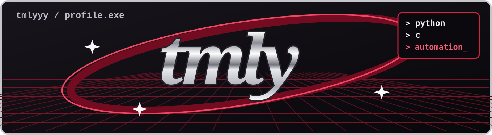
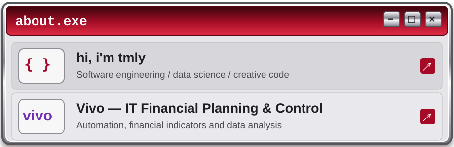
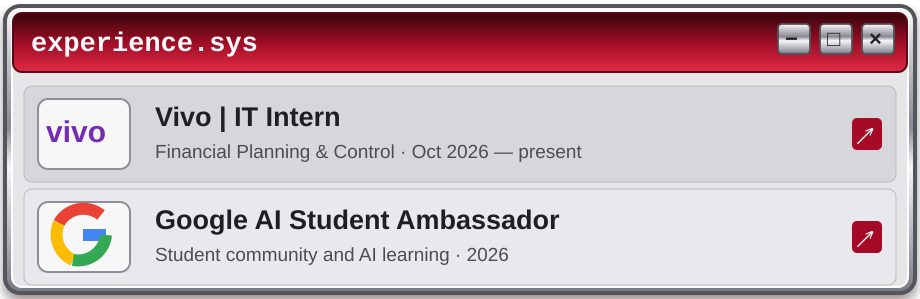
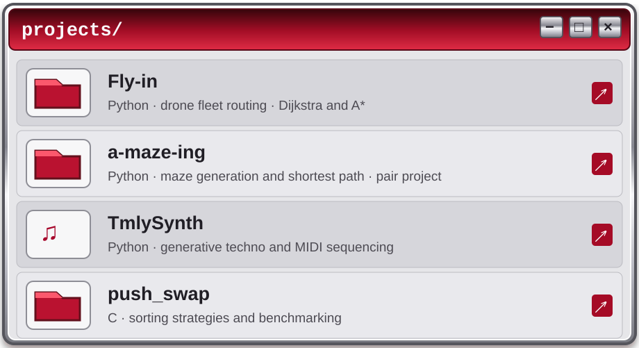
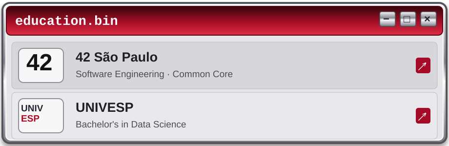
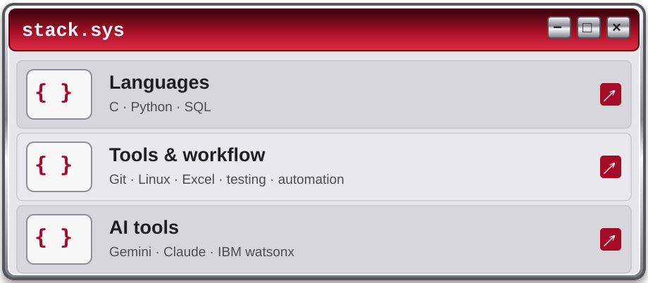
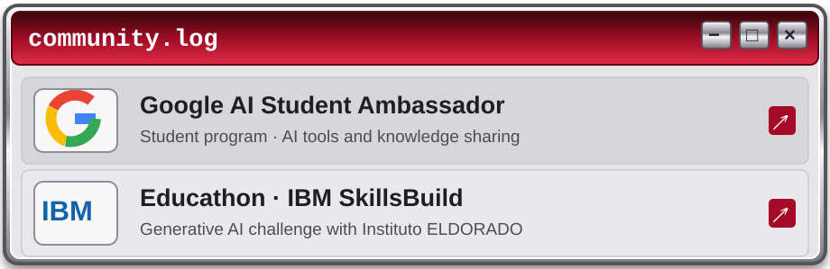

 

<table><tr>
<td width="50%" valign="top">

Software Engineering at <b>42 São Paulo</b>, Data Science at <b>UNIVESP</b> and IT Financial Planning &amp; Control at <b>Vivo</b>. I work with data, indicators and process automation, and love building things with code.

</td>
<td width="50%" valign="top">

<b>Vivo</b> — IT internship focused on financial planning, reporting and automation. <b>Google AI Student Ambassador</b> — student ambassador program (not Google employment).

</td></tr><tr>
<td valign="top">

<a href="https://github.com/tmlyyy/Fly-in">↗ Fly-in</a> · <a href="https://github.com/tmlyyy/a-maze-ing">↗ a-maze-ing</a> · <a href="https://github.com/tmlyyy/TmlySynth">↗ TmlySynth</a> · <a href="https://github.com/tmlyyy/push_swap">↗ push_swap</a> · <a href="https://github.com/tmlyyy/libft">↗ libft</a>

</td><td valign="top">

</td></tr><tr>
<td valign="top">

Generative AI challenge with <b>Instituto ELDORADO / IBM SkillsBuild</b>, plus personal projects combining algorithms, music and technology.
</td>
<td valign="top">
<h3>activity.log</h3>

</td></tr></table>

tmly.exe · code / data / automation / creative tech
