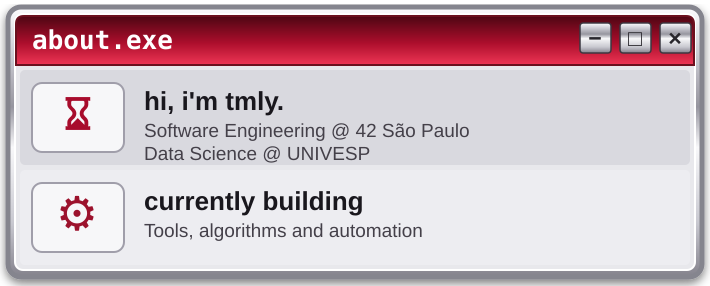
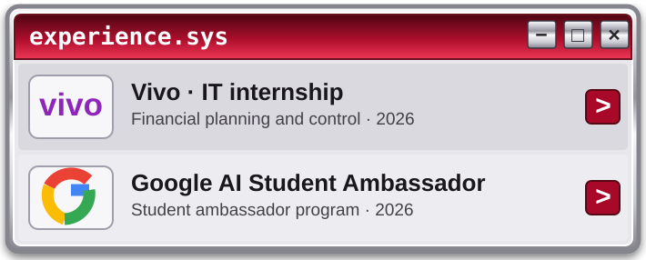
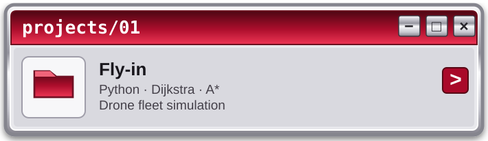
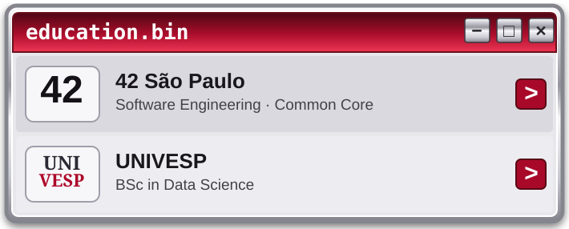
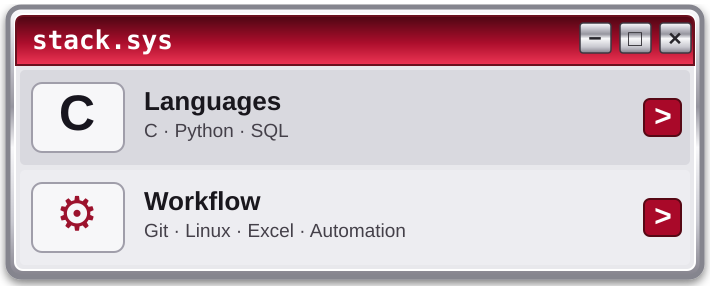
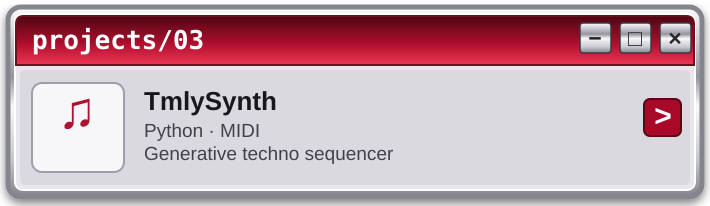
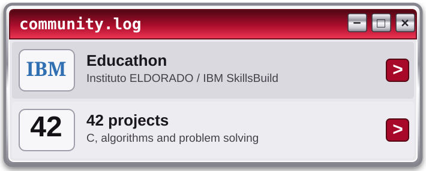
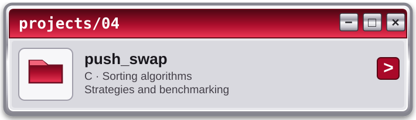

<strong>software engineering · data science · automation</strong>

 
<table><tbody>
<tr><td width="50%" valign="top"></td><td width="50%" valign="top"></td></tr>
<tr><td width="50%" valign="top"></td><td width="50%" valign="top"></td></tr>
<tr><td width="50%" valign="top"></td><td width="50%" valign="top"></td></tr>
<tr><td width="50%" valign="top"></td><td width="50%" valign="top"></td></tr>
<tr><td width="50%" valign="top"></td><td width="50%"></td></tr>
</tbody></table>

Vivo · Google AI Student Ambassador · 42 São Paulo · UNIVESP 
All project panels link to their repositories. The interactive desktop portfolio is linked above.
