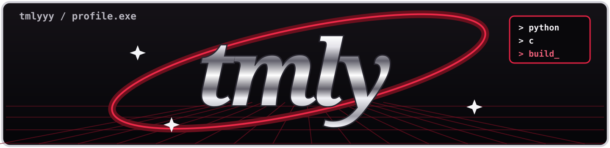

**software engineering · data science · automation · creative coding**

---

<table>
<tr>
<td width="50%" valign="top">

### ◈ about.exe

**hi, i'm tmly.**

Studying Software Engineering at **42 São Paulo** and Data Science at **UNIVESP**. Currently an **IT intern at Vivo**, working with financial planning, indicators and automation.

I like solving problems, experimenting with code and building useful things.

✦ More about me

I'm a **Google AI Student Ambassador** and have a background in Dentistry and Business Administration. I explore the intersection of technology, product and business.

</td>
<td width="50%" valign="top">

### ◈ experience.sys

 **[IT Intern · Vivo](https://www.linkedin.com/in/thamily-victoria-744802188/)**  
Financial Planning & Control · since Oct 2026

 **[Google AI Student Ambassador](https://www.linkedin.com/in/thamily-victoria-744802188/)**  
Student ambassador program · 2026

✦ What I work with

Data analysis, spreadsheets, indicators, automations, and experiments with AI tools. Ambassador refers to a student program, not Google employment.

</td>
</tr>
<tr>
<td valign="top">

### ◈ projects/

📁 **[Fly-in ↗](https://github.com/tmlyyy/Fly-in)**  
Python · Dijkstra · A* · HTML visualization  
Multi-drone routing with zone and connection capacity constraints.

📁 **[a-maze-ing ↗](https://github.com/tmlyyy/a-maze-ing)**  
Python · DFS · BFS · 42 São Paulo  
Maze generator and shortest-path solver, developed in a pair.

♫ **[TmlySynth ↗](https://github.com/tmlyyy/TmlySynth)**  
Python · MIDI · creative coding  
Generative techno sequencer with algorithmic rhythm patterns.

📁 **[push_swap ↗](https://github.com/tmlyyy/push_swap)**  
C · sorting algorithms · benchmarking  
Stack-based sorting with multiple strategies.

+ More projects

- [libft](https://github.com/tmlyyy/libft) — custom C library
- [printf](https://github.com/tmlyyy/printf) — formatted printing in C
- [get_next_line](https://github.com/tmlyyy/get_next_line) — file-reading utilities in C

</td>
<td valign="top">

### ◈ education.bin

  
**[42 São Paulo ↗](https://www.42sp.org.br/)**  
Software Engineering · Common Core

  
**[UNIVESP ↗](https://univesp.br/)**  
BSc in Data Science

### ◈ stack.sys

`C` `Python` `SQL` `Git` `Linux` `Excel` `Automation`

✦ AI and community

**Google AI Student Ambassador** · AI learning and knowledge-sharing activities

**Educathon — Instituto ELDORADO + IBM SkillsBuild** · tested prompts with IBM watsonx, Gemini and Claude

### ◈ links/

**[GitHub ↗](https://github.com/tmlyyy)** · **[LinkedIn ↗](https://www.linkedin.com/in/thamily-victoria-744802188/)** · **[Portfolio ↗](https://tmlyyy.github.io/tmlyyy/)**

</td>
</tr>
</table>

---

tmly.exe · code / data / creativity · São Paulo, Brazil

